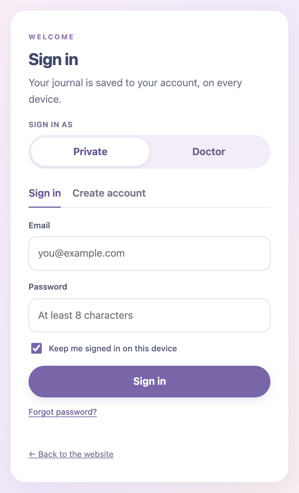
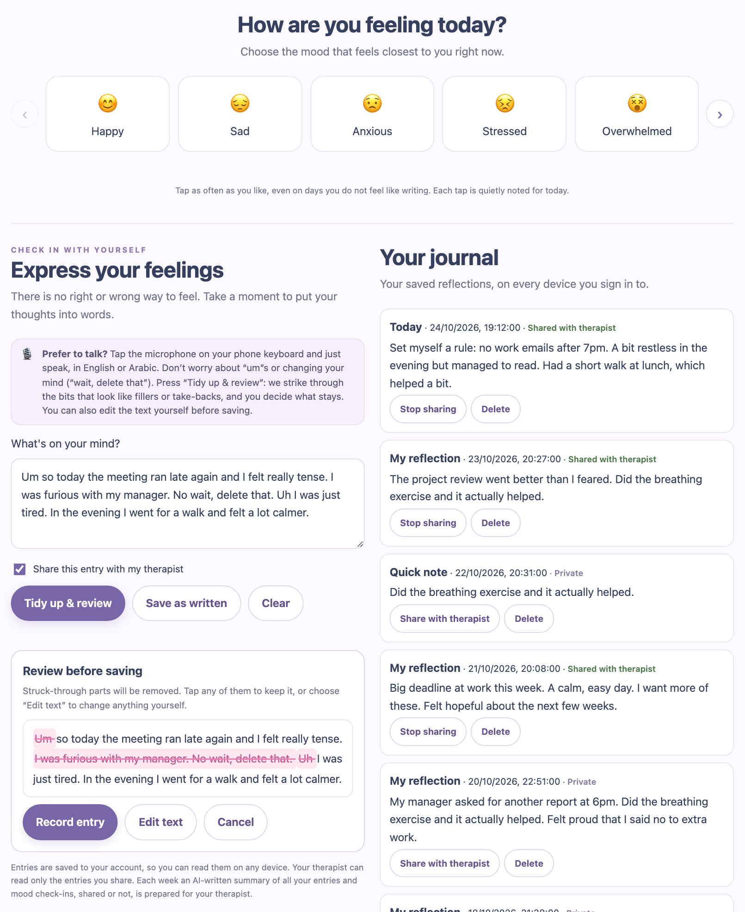
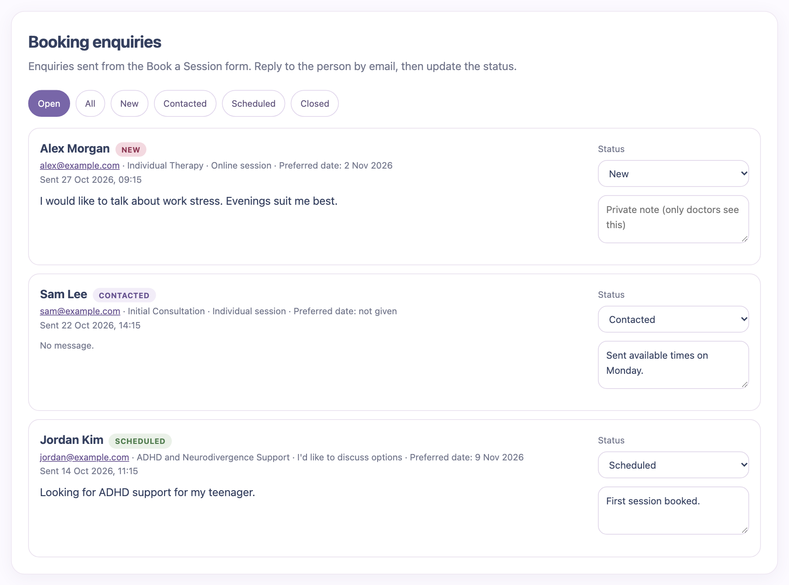
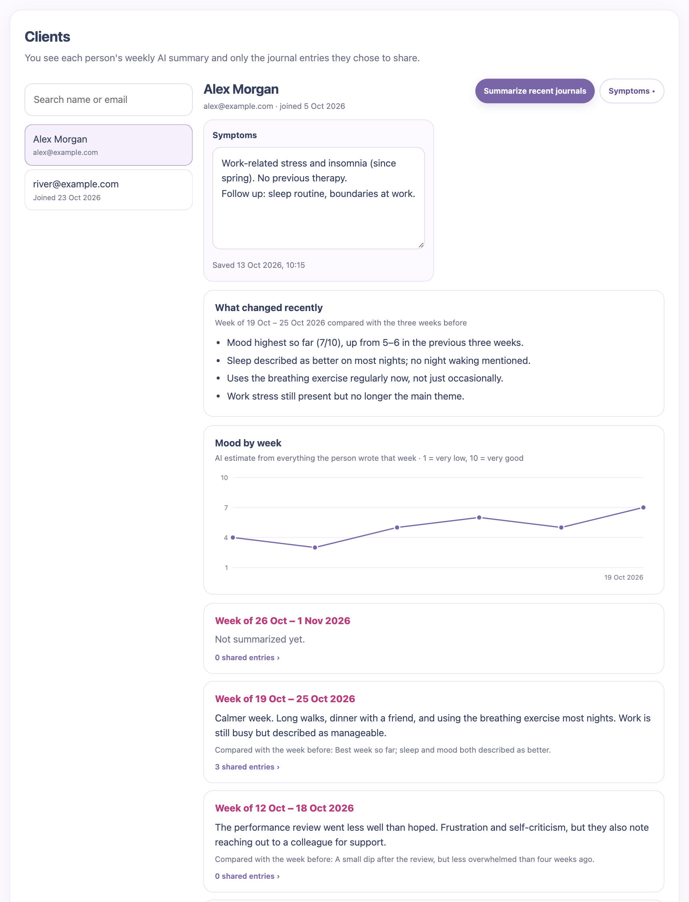
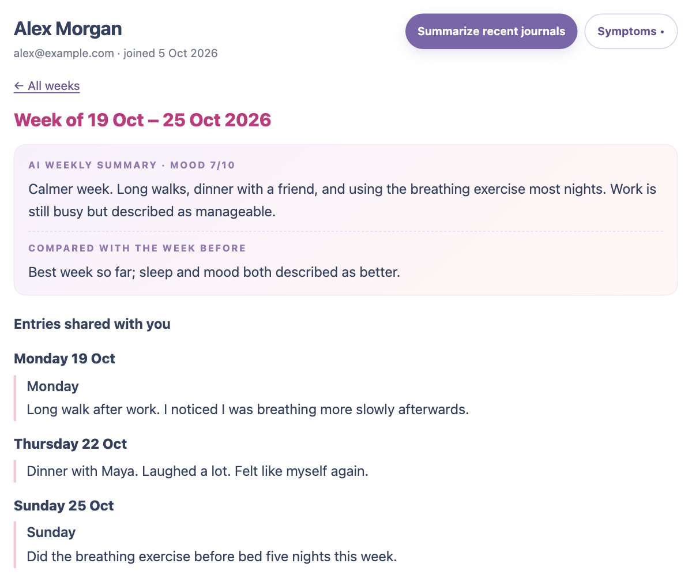
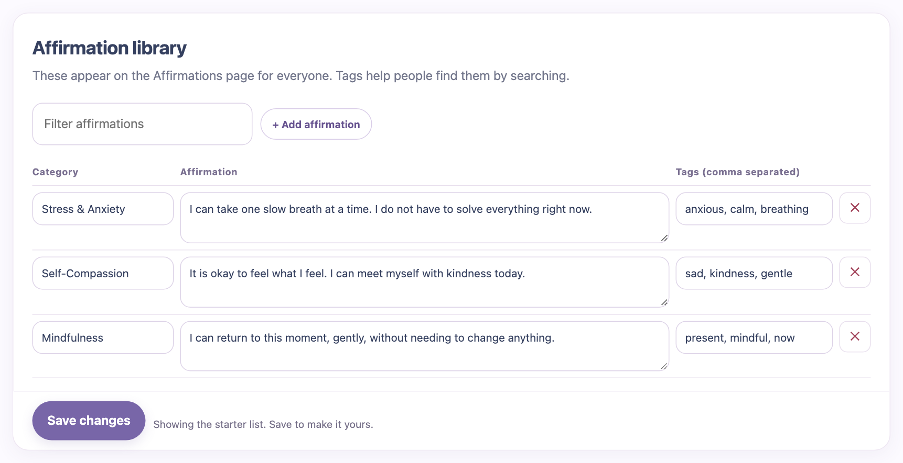
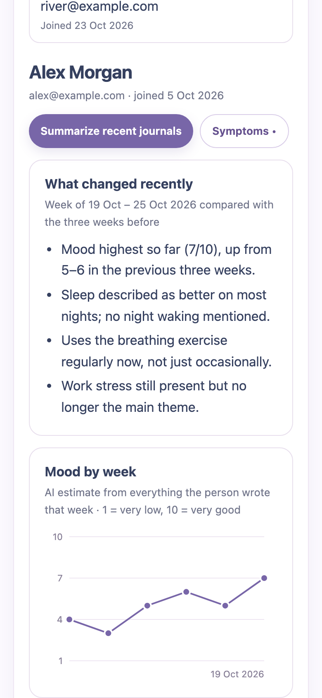
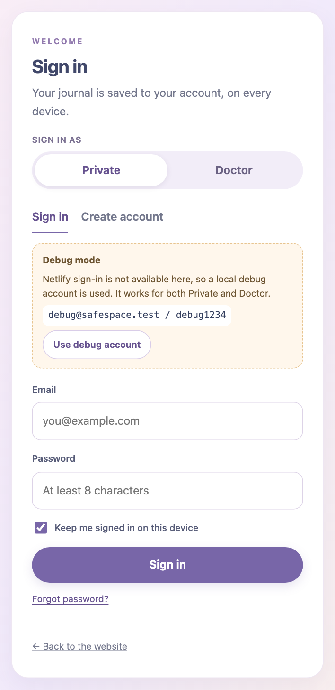

# Safe Space Therapy

A gentle wellness website with two kinds of accounts:

- **Private**: the people who use the site. They write a journal, find affirmations and send booking enquiries.
- **Doctor**: the therapist. They see booking enquiries, weekly AI summaries, the journal entries each person chose to share, and they edit the affirmation library.

It runs on Netlify (pages, sign-in and storage). Weekly AI summaries come from Qwen on a small AWS server that is switched off except when a doctor asks for summaries.

> Screenshots below use made-up sample data (debug mode and `doctor.html?demo=1`). No real person's data is shown.

---

## Pages

Each page has one job:

| Menu | What is on it |
|---|---|
| **Home** (`index.html`) | Welcome banner, "How are you feeling today?", and four cards leading to the other pages |
| **Journal** (`journal.html`) | "How are you feeling today?", writing with Tidy up & review, and your saved entries |
| **Affirmations** (`affirmations.html`) | A featured affirmation, search and topics, and Your Favorites |
| **Services & Booking** (`booking.html`) | Services & Pricing and the booking enquiry form |
| **FAQ & Contact** (`contact.html`) | About us with a "Check our therapist" button, contact details, FAQ |
| (not in the menu) `about.html` | The therapist page, opened from "Check our therapist" |

All five menu pages are copies of the same HTML. A small `<style id="page-layout">` block in each page decides which sections that page shows, so a section is edited in all copies but appears on one page only.

---

## Tour

### Sign in

People choose **Private** or **Doctor**. Private people can create an account; doctor accounts are invite-only. "Keep me signed in" keeps them signed in on that device for 30 days.



### Mood check-in

"How are you feeling today?" appears on the home page and at the top of the journal, and both work the same way. People can tap any mood as often as they like; each tap floats up with a small animation and is counted for today. The counts become one hidden line at the top of that day's journal, for example 3 × Happy + 1 × Sad gives "I feel very happy and a bit sad today." (1 tap = "a bit", 2 = "quite", 3 or more = "very"; if every mood was tapped once, no strength words are added). The person never sees this line and the doctor does not see it as an entry; only the weekly AI summary reads it. This notes how someone feels even on days they do not want to write.

### Journal with "Tidy up & review"

People can type, or dictate with the microphone on their phone keyboard. Before saving, **Tidy up & review** strikes through fillers (uh, um, امم) and spoken take-backs ("no wait, delete that"). They tap any struck-through part to keep it, or choose **Edit text** to change it by hand, then press **Record entry**. Text is only ever removed, never added. This runs in the browser; no AI is involved.

Each entry can be shared with the therapist, or kept private.



### Affirmations

More than 100 affirmations in 13 topics. People search or pick a topic, and tap **♡ Save** on any affirmation (including the featured one). Saved affirmations appear under **Your Favorites** with a **Remove** button, and are kept in their account.

### Doctor: booking enquiries

Enquiries from the Book a Session form (including the service type the person chose, such as Individual Therapy or Marriage Counselling), with a status and a private note for each.



### Doctor: a person's page

From top to bottom:

1. Name, **Summarize recent journals** and **Symptoms** (the doctor's own notes, saved automatically, only doctors see them).
2. **What changed recently**: 2–5 points comparing the latest summarised week with the three weeks before.
3. **Mood by week**: a line for every summarised week (1 = very low, 10 = very good). Only the latest week's date is written on the axis; hover a point to see its week.
4. One box per week, newest first: the date in pink, the summary, and how it compares with the week before.

Nothing is summarised until the doctor presses **Summarize recent journals**.



### Doctor: one week

Tapping a week box opens that week: the summary, then every entry the person shared, Monday to Sunday. Entries that were not shared never reach the doctor. Arabic entries are shown right to left.



### Doctor: affirmation library

The affirmations shown on the site. Changes are live as soon as they are saved.



### On a phone

Every page works at phone width.



---

## Debug mode (opening the site locally or from GitHub)

When the site is opened as a file (double-click), from `localhost`, or from `*.github.io`, it runs in **debug mode**. On the Netlify site and on your own domain, debug mode is always off.

- Nothing is sent anywhere. Accounts, journals, bookings and affirmations are kept in this browser's localStorage.
- It starts with four made-up people, each with five full weeks of entries; every week 1–3 days are shared with the doctor:
  - Sara Ahmed and Lina Karim (English), Omar Haddad and Yusuf Nasser (Arabic)
  - They can also sign in as Private: `sara@example.test`, `lina@example.test`, `omar@example.test`, `yusuf@example.test`, password `debug1234`.
- **Summarize recent journals** simulates the AI server: "starting" for a few seconds, then sample summaries.
- A small banner at the bottom shows debug mode is on. **Reset debug data** wipes everything and recreates the sample people.
- `doctor.html?demo=1` shows the Doctor page filled with fixed sample data (no sign-in, nothing saved).
- To test the real Netlify backend on localhost (`netlify dev`), open any page with `?live=1` (`?live=0` to go back).

### The debug account and the hidden debug box

There is one debug account that signs in as **both** Private and Doctor (pick the role on the sign-in page):

| Email | Password |
|---|---|
| `debug@safespace.test` | `debug1234` |

The yellow **Debug mode** box on the sign-in page (with a "Use debug account" button) is **hidden**. To show it:

1. Type **`steffiroshan`** in the **Password** field.
2. Press **Sign in** **5 times in a row**. The first four presses just say the password is incorrect.
3. On the fifth press the box appears, and the password field is cleared.

Typing another password resets the count. Once shown, the box stays for the rest of that browser tab's session. The debug account works whether or not the box is shown. This only tidies the sign-in screen; it is not a security feature, because debug mode never runs on the Netlify site and its data never leaves the browser.



---

## What is in this repository

| Path | What it is |
|---|---|
| `index.html`, `journal.html`, `affirmations.html`, `booking.html`, `contact.html`, `about.html` | The Private pages (see **Pages** above). Everyone must sign in first. |
| `login.html` | Sign in as Private or Doctor. |
| `doctor.html` | The Doctor page. |
| `assets/` | Page scripts (`auth.js`, `private.js`, `doctor.js`, `login.js`, `dev-backend.js`, …) and `site.css`. |
| `assets/build/` | The bundled scripts the pages actually load. Rebuilt by `npm run build`. |
| `netlify/functions/` | The server side (Netlify Functions). Data is kept in Netlify Blobs. |
| `ai-worker/` | The AI summary worker for the AWS server (`worker.mjs`, `safespace-worker.service`, `setup.sh`). |
| `scripts/build.mjs` | Bundles `assets/*.js` into `assets/build/`, and on Netlify copies the site into `dist/`. |
| `scripts/screenshots.mjs` | Re-takes the screenshots in `docs/screenshots/`. |
| `affirmations.json` | Old reference copy. The live list is edited on the Doctor page. |

## Where data is stored (all on Netlify)

- **Accounts**: Netlify Identity. A Doctor is a user with the role `doctor`.
- **Journal entries**: Netlify Blobs, store `journals`, key `<userId>/<entryId>`:
  `{ id, userId, title, text, shared, created, week }` (`week` is the Monday of that week, `YYYY-MM-DD`).
- **Booking enquiries**: store `bookings`.
- **Affirmation library**: store `site`, key `affirmations`.
- **Weekly AI summaries**: store `summaries`, key `<userId>/<week>`, written by the AWS worker:
  `{ week, mood (1-10), summary (≤100 words), comparison, changes (2-5 points), entryCount, generatedAt }`.
- **Doctor's Symptoms notes**: store `doctor-notes`, key `<userId>`. Only doctors can read them.
- **Weeks waiting for a summary**: store `summary-queue`. Job status: store `site`, key `summary-job`.
- **Saved affirmations (Your Favorites)**: store `favorites`, key `<userId>`.
- **Mood check-ins**: in the `journals` store as a hidden item `<userId>/mood-<YYYY-MM-DD>` with `kind: "mood"`, the tap counts and the sentence. Never shown in the person's journal or to the doctor as an entry.

## Who sees what

- A Private user sees only their own journal.
- The Doctor sees booking enquiries, the list of Private accounts, the entries each person chose to share, and the weekly AI summary. The Doctor never receives entries that were not shared.
- The journal page tells people that the weekly AI summary covers all their entries and mood check-ins, shared or not.

## The weekly AI summary

Qwen runs on an AWS EC2 server that is normally switched off.

- Saving, editing or deleting a journal entry puts that person's week in the `summary-queue`.
- Nothing is summarised automatically. When the doctor presses **Summarize recent journals**, the site starts the EC2 server (only if some week is waiting).
- At boot the worker summarises every waiting week for everyone (the opened person first, older weeks first). It reads the written entries and the mood check-ins. For each week it writes a mood score, a summary of up to 100 words, a comparison with the week before, and 2–5 points on what changed compared with the three weeks before. Then the server powers off.
- If any entry mentions self-harm, suicide or harming someone, the summary starts with "Safety note:".
- The Doctor page shows the progress and reloads the person's page when their weeks are ready.

Netlify environment variables (Site configuration → Environment variables), then redeploy:

| Variable | Value |
|---|---|
| `SUMMARY_WORKER_KEY` | A long random secret (e.g. `openssl rand -hex 32`). Also goes on the server. |
| `SUMMARY_EC2_INSTANCE_ID` | e.g. `i-0123456789abcdef0` |
| `SUMMARY_EC2_REGION` | e.g. `eu-north-1` |
| `SUMMARY_AWS_ACCESS_KEY_ID` | Access key of an IAM user that may only start that one server |
| `SUMMARY_AWS_SECRET_ACCESS_KEY` | Its secret |

Without them, the Doctor page says "the AI server is not connected yet" and nothing else changes.

## One-time setup on Netlify

1. Deploy from Git (this repository). Drag-and-drop deploys do **not** include the Functions, so sign-in and saving would not work.
2. Netlify dashboard → your site → **Identity**: Enable Identity.
3. Identity → Registration: **Open** (so Private people can sign up). Keep email confirmation on.
4. Create the Doctor account: Identity → **Invite users** → the doctor's email. After they accept, open the user → Edit → Roles: type `doctor` and save. The doctor then signs in with **Doctor** selected.
5. Optional: Identity → Emails, to change the invite / confirmation / reset email texts.

## AWS setup (one time, about 30 minutes)

1. AWS console, region **Europe (Stockholm) eu-north-1**. Billing → Budgets: create a monthly budget alert (e.g. $10).
2. EC2 → **Launch instance**:
   - Name `safespace-ai`, **Ubuntu Server 24.04 LTS, 64-bit (Arm)**, instance type **t4g.large** (8 GB)
   - Key pair: create one (ED25519) and download the `.pem` file
   - Network: allow SSH (22) from **My IP** only. No other inbound rules (the server only makes outgoing calls).
   - Auto-assign public IP: Enable (no Elastic IP needed; you only pay for the IP while it runs)
   - Storage: 20 GB gp3, encrypted
3. From your Mac, copy the worker and log in (use your `.pem` path and the server's current public IP):
   ```bash
   chmod 400 ~/Downloads/safespace-ai.pem
   ```
   ```bash
   scp -i ~/Downloads/safespace-ai.pem -r ai-worker ubuntu@<IP>:~
   ```
   ```bash
   ssh -i ~/Downloads/safespace-ai.pem ubuntu@<IP>
   ```
4. On the server: `cd ~/ai-worker && sudo bash setup.sh`. It installs Node and Ollama, downloads the model (`qwen3.5:4b` by default; check the exact tag on ollama.com first, e.g. `sudo MODEL=qwen3.5:4b bash setup.sh`) and asks for the site URL and `SUMMARY_WORKER_KEY`.
5. Test on the server (runs once without powering off):
   `sudo bash -c 'set -a; . /etc/safespace-worker.env; FORCE=1 node /opt/safespace-worker/worker.mjs'`
   Then stop the server: EC2 → Instances → Stop (or `sudo poweroff`).
6. IAM → Users → Create user `safespace-netlify` (no console access) with this inline policy (replace the account and instance IDs):
   ```json
   { "Version": "2012-10-17", "Statement": [{ "Effect": "Allow", "Action": "ec2:StartInstances",
     "Resource": "arn:aws:ec2:eu-north-1:<ACCOUNT_ID>:instance/<INSTANCE_ID>" }] }
   ```
   Security credentials → Create access key ("Application running outside AWS"). Put the key pair and the instance ID into the Netlify variables above and redeploy.
7. Check: write a journal entry as a Private user, open that person as the Doctor and press **Summarize recent journals**. The page says it is starting the AI server; a few minutes later the summary appears and the server stops by itself (EC2 → Instances).

Notes:

- The server powers off only when a doctor started it. If you start it yourself in the console for maintenance, it stays on until you stop it. Every run is capped at 2 hours.
- Logs on the server: `journalctl -u safespace-worker -n 100`
- Cost: the stopped server only costs its 20 GB disk (about $2/month). Running time costs a few cents per hour.

## Editing the scripts

- Edit the files in `assets/*.js`, then run `npm install` (once) and `npm run build`. This updates `assets/build/`, which the pages load. Commit `assets/build/` too, so opening the files locally keeps working.
- Netlify runs `npm run build` on every deploy and publishes the `dist/` folder (only the public site files).
- To refresh the screenshots in this README: serve the site with `python3 -m http.server 8765`, then run `npm run screenshots` (needs Google Chrome).

## Before launch

- Confirm fees, services, the therapist bio, qualifications and languages.
- Journal entries are mental-health information (special category data under GDPR). Before real people join: add a privacy notice (what is stored, where, who can read it, the AI summary, how to delete), get clear consent for the AI summary, and check Netlify's and AWS's data processing agreements and storage regions.
- Google Analytics is not set up.

This is a supportive wellness website, not a clinical record system or an emergency service.
